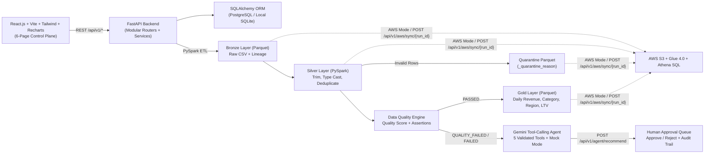

# DataPilot AI – Agentic Data Engineering and Intelligent Analytics Platform

[](https://www.python.org/)
[](https://fastapi.tiangolo.com/)
[](https://react.dev/)
[](https://spark.apache.org/)
[](https://ai.google.dev/)
[](https://aws.amazon.com/)
[](LICENSE)

**DataPilot AI** is an end-to-end **Agentic Data Engineering and Intelligent Analytics Platform** built for production-aligned Medallion ETL pipelines. It ingests e-commerce order data, cleans and transforms it with **PySpark** across **Bronze → Silver → Gold**, stores operational metadata in **PostgreSQL / SQLite via SQLAlchemy**, monitors data quality, and uses a **Google Gemini tool-calling AI agent** with human-in-the-loop approvals served through a **FastAPI** backend and **React + Tailwind + Recharts** frontend.

Repository: [https://github.com/Abhishek-Kr-Nishad/DataPilot-AI](https://github.com/Abhishek-Kr-Nishad/DataPilot-AI)

---

## Architecture



---

## Technology Stack

- **Frontend**: React 18, Vite, Tailwind CSS, Recharts, Lucide React
- **Backend**: FastAPI, Uvicorn, Pydantic v2, Dependency Injection, CORS
- **Data Engineering**: Apache Spark / PySpark, Parquet, Medallion Architecture (Bronze / Silver / Quarantine / Gold)
- **Database**: PostgreSQL + SQLAlchemy 2.0 ORM (with automatic local SQLite fallback when `POSTGRES_DSN` is unset)
- **Agentic AI**: Google Gemini API (`google-genai`), function tool-calling, structured outputs, offline mock mode, human approval gate
- **AWS Cloud**: `boto3` (Amazon S3), AWS Glue 4.0 ETL script (`aws/glue_etl_job.py`), Amazon Athena SQL (`sql/athena/`)
- **Testing & Containers**: Pytest, FastAPI `TestClient`, `botocore.stub.Stubber`, Docker & Docker Compose

---

## Folder Structure

```text
DataPilot AI/
├── .env.example
├── requirements.txt
├── pyproject.toml
├── Dockerfile                        # Backend container (Python 3.11 + OpenJDK 17 + Uvicorn)
├── docker-compose.yml                # Backend + Frontend + PostgreSQL stack
├── frontend/
│   ├── Dockerfile                    # Multi-stage Vite build + Nginx reverse proxy
│   ├── nginx.conf
│   ├── package.json
│   └── src/
│       ├── api/client.js             # FastAPI REST client
│       ├── components/               # StatusBadge, KpiCard, LoadingPanel, ErrorBanner, EmptyState
│       └── pages/                    # Overview, Pipeline Management, Data Quality, AI Agent, Analytics, History
├── src/datapilot/
│   ├── api/
│   │   ├── main.py                   # Single FastAPI app factory + lifespan
│   │   └── routers/                  # health, pipeline, quality, analytics, agent, aws
│   ├── core/                         # config.py & secret-redacting logging.py
│   ├── schemas/                      # domain.py & api.py Pydantic models
│   ├── models/                       # SQLAlchemy ORM models (orm.py)
│   ├── database/                     # SQLAlchemy Engine & session management (session.py)
│   ├── dependencies/                 # ServiceContainer & FastAPI Depends providers
│   ├── services/                     # pipeline_service, analytics_service, agent_service, aws_service
│   ├── pipeline/                     # schemas, bronze, silver, quality, gold, runner
│   ├── agent/                        # tools.py (5 tools), approval.py, engine.py (Gemini + mock)
│   ├── storage/                      # base.py, local_storage.py, s3_storage.py
│   ├── metadata/                     # store.py (SQLAlchemy + JSON mirror)
│   ├── data_generator.py             # Reproducible seeded CSV generator + failure scenarios
│   └── spark_session.py              # Windows & Spark 4 safe SparkSession builder
├── aws/
│   ├── deploy_config.example.json
│   ├── glue_catalog_ddl.py
│   └── glue_etl_job.py
├── sql/athena/
│   ├── 01_create_database.sql ... 05_validation_queries.sql
├── scripts/
│   ├── run_api.py
│   ├── run_local_pipeline.py
│   └── sync_to_aws.py
└── tests/
```

---

## Installation & Local Execution

### 1. Backend Setup (Python 3.11 `.venv`)
```powershell
# On Windows, ensure Python 3.11 is used to create .venv
C:\Users\HP\AppData\Local\Programs\Python\Python311\python.exe -m venv .venv
.\.venv\Scripts\Activate.ps1
python --version   # Must print Python 3.11.x
pip install -r requirements.txt
copy .env.example .env
```

> **Windows Spark Note:** Install Java (JDK 17/21/24). If `winutils.exe` exists at `C:\Winutils\bin\winutils.exe`, DataPilot AI auto-configures `HADOOP_HOME`.

### Environment Configuration

Copy `.env.example` to `.env` and configure overrides without ever committing `.env`:

| Variable | Default | Purpose |
| --- | --- | --- |
| `DATAPILOT_EXECUTION_MODE` | `local` | `local` (filesystem + SQLite/Postgres) or `aws` |
| `DATAPILOT_METADATA_BACKEND` | `sqlalchemy` | `sqlalchemy` (SQLite/Postgres), `postgres`, or `json` |
| `POSTGRES_DSN` / `DATABASE_URL` | `""` | Optional PostgreSQL SQLAlchemy connection string |
| `GEMINI_API_KEY` | `""` | Optional Google Gemini API key (`mock` mode works without it) |
| `DATAPILOT_AGENT_MODE` | `auto` | `auto`, `mock`, or `gemini` |
| `AWS_S3_BUCKET` / `AWS_REGION` | `""` / `us-east-1` | Target S3 bucket and region for AWS cloud sync |
| `AWS_GLUE_JOB_NAME` / `AWS_GLUE_DATABASE` | `datapilot-ecommerce-etl` | Glue ETL job and Athena catalog database |

### 2. Start Backend (FastAPI + Swagger UI)
```powershell
.\.venv\Scripts\python.exe scripts\run_api.py --host 127.0.0.1 --port 8000
```
- Health check: `http://127.0.0.1:8000/health`
- Interactive Swagger Docs: `http://127.0.0.1:8000/docs`

### 3. Start Frontend (React + Vite + Tailwind + Recharts)
```powershell
cd frontend
npm install
npm run dev
```
Open `http://127.0.0.1:5173`. Vite proxies `/health` and `/api/*` requests directly to FastAPI (`http://127.0.0.1:8000`).

### 4. Run Local PySpark CLI Pipeline Directly
```powershell
.\.venv\Scripts\python.exe scripts\run_local_pipeline.py --scenario clean --rows 250 --seed 42
.\.venv\Scripts\python.exe scripts\run_local_pipeline.py --scenario dirty_nulls_duplicates --rows 120 --seed 7
```

---

## API Documentation (`/api/v1/*`)

| Method | Endpoint | Purpose |
| --- | --- | --- |
| `GET` | `/health` | Active mode (`local` vs `aws`), DB dialect, Gemini & AWS readiness |
| `POST` | `/api/v1/pipeline/run` | Generate synthetic e-commerce batch and execute PySpark ETL |
| `POST` | `/api/v1/pipeline/upload` | Upload raw `.csv` file and execute PySpark ETL |
| `GET` | `/api/v1/pipeline/status` | Aggregate run counts and latest/selected run status |
| `GET` | `/api/v1/pipeline/runs` | Execution history list (`?limit=`, `?status=`) |
| `GET` | `/api/v1/pipeline/runs/{run_id}/layers/{layer}` | Preview Bronze, Silver, Quarantine, or Gold Parquet records |
| `GET` | `/api/v1/quality/report` | Quality score, assertion details, null rates, quarantine breakdown |
| `GET` | `/api/v1/analytics/summary` | Aggregated Gold revenue, category, regional, and customer LTV metrics |
| `POST` | `/api/v1/agent/diagnose` | Run Gemini/mock 5-tool failure diagnosis & Athena SQL generation |
| `POST` | `/api/v1/agent/recommend` | Generate recovery proposal requiring human approval |
| `GET` | `/api/v1/agent/recommendations` | List recovery plans (`PENDING_APPROVAL`, `APPROVED`, `REJECTED`) |
| `POST` | `/api/v1/agent/approvals/{id}/approve` | Record explicit human approval in audit log |
| `POST` | `/api/v1/agent/approvals/{id}/reject` | Record explicit human rejection in audit log |
| `GET` | `/api/v1/aws/status` | Credential-safe AWS configuration summary |
| `GET` | `/api/v1/aws/athena-sql` | Athena DDL & validation SQL scripts |
| `POST` | `/api/v1/aws/sync/{run_id}` | Upload local run artifacts to S3 (blocked with `400` if AWS unconfigured) |

---

## Agentic AI Workflow

`DiagnosticAgent` (`src/datapilot/agent/engine.py`) orchestrates five strictly bounded tools in `DiagnosticToolbox` (`src/datapilot/agent/tools.py`):

1. `inspect_pipeline_status()` — reads run manifest, layers, errors, and log tail.
2. `inspect_quality_report()` — reads quality assertions, null rates, and quarantine counts.
3. `identify_failure_reason()` — classifies root cause (`SCHEMA_DRIFT`, `NULL_SPIKE_AND_DUPLICATES`, `CORRUPT_OR_INVALID_RECORDS`, `EMPTY_INPUT_DATASET`, etc.) with evidence.
4. `generate_sql_validation()` — builds read-only Amazon Athena validation SQL checked by `validate_read_only_sql()`.
5. `recommend_recovery()` — emits a non-destructive `RecoveryRecommendation` locked at `requires_human_approval=True`, `approval_status="PENDING_APPROVAL"`, and `auto_executed=False`.

Set `GEMINI_API_KEY` in `.env` to enable Google Gemini (`google-genai`) synthesis with tool declarations; leave unset or use `mode="mock"` for deterministic offline execution.

---

## Testing Instructions (Separated Suites)

```powershell
# 1. Config, SQLAlchemy DB, Data Generator & Mocked AWS/Athena Unit Tests
.\.venv\Scripts\python.exe -m pytest tests/test_config_and_generator.py tests/test_aws_storage_and_glue.py -k "not glue_etl_job"

# 2. Gemini Agent & Approval Gate Tests (Offline Mock + Mocked Gemini Client)
.\.venv\Scripts\python.exe -m pytest tests/test_diagnostic_agent.py

# 3. FastAPI Endpoint Tests (Non-Spark)
.\.venv\Scripts\python.exe -m pytest tests/test_api.py -k "not end_to_end"

# 4. PySpark Medallion, Glue Compatibility & Full Integration Tests
.\.venv\Scripts\python.exe -m pytest tests/test_bronze_silver_gold.py tests/test_end_to_end_pipeline.py tests/test_aws_storage_and_glue.py tests/test_api.py -k "bronze or end_to_end or glue_etl_job or corrupt or schema_drift or empty_file or dirty_nulls"

# 5. Frontend Production Build Check
cd frontend && npm run build
```

---

## AWS Deployment Roadmap

Local execution never claims AWS deployment (`effective_mode="local"`, `aws_synced=false`). To deploy to AWS when credentials are available:
1. Create an S3 bucket and configure `AWS_S3_BUCKET`, `AWS_REGION`, and IAM role / profile / env credentials.
2. Run Athena DDLs in `sql/athena/` (`01`–`04`) or `aws/glue_catalog_ddl.py`.
3. Upload `aws/glue_etl_job.py` and batch artifacts via `python scripts/sync_to_aws.py --upload-glue-script`.
4. Trigger Glue ETL runs (`--trigger-glue-job`) and query Gold tables in Amazon Athena using `05_validation_queries.sql`.

---

## Development Roadmap

- **Completed**:
  - PySpark Medallion pipeline (Bronze, Silver, Quarantine, 4 Gold analytical tables)
  - Deterministic data quality engine & quality score calculation
  - Modular FastAPI REST backend (`/api/v1/*`) + SQLAlchemy ORM (SQLite/PostgreSQL)
  - Google Gemini tool-calling diagnostic agent (`mock` + `gemini` modes) with human-in-the-loop approval gate
  - React + Vite + Tailwind CSS + Recharts 6-page analytics & monitoring dashboard
  - AWS S3 `boto3` storage backend, AWS Glue 4.0 ETL script, Amazon Athena DDLs, and Docker Compose stack
- **Upcoming**:
  - Live AWS cloud integration tests against dedicated sandbox AWS S3/Glue/Athena account
  - Streaming ingestion support via Kafka / Spark Structured Streaming into Bronze
  - Automated CI/CD GitHub Actions workflow running unit, PySpark, and frontend build checks

---

## Containerization (Docker Compose)
```bash
docker compose up --build
```
- Frontend: `http://localhost:3000`
- Backend API & Swagger: `http://localhost:8000/docs`
- PostgreSQL Metadata DB: `localhost:5432`
